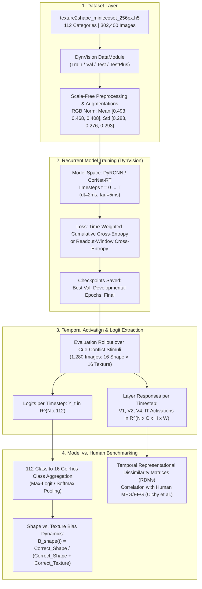

# Training DynVision on 112-Class Mini-Ecoset & Multi-Timestep Model-vs-Human Analysis

This guide outlines the end-to-end pipeline for training biologically inspired recurrent vision models (**DyRCNN**, **CorNet-RT**) on the newly constructed 112-class Mini-Ecoset dataset (`texture2shape_miniecoset_256px.h5`), instrumenting temporal representations across recurrent timesteps $t \in [0, T]$, and conducting decision-level and representational **Model vs. Human** benchmarks (cue-conflict shape vs. texture bias and neural representational similarity analysis).

---

## 1. Pipeline Overview & Scientific Architecture



---

## 2. Dataset Integration in DynVision

The 112 classes in `texture2shape_miniecoset_256px.h5` natively incorporate the **100 Mini-Ecoset base categories** (Thorat et al.) plus the **12 supplementary Ecoset categories** required to cover all 16 Geirhos cue-conflict categories (`bear`, `boat`, `bottle`, `car`, `chair`, `stove`, `typewriter`, `horse`, `house`, `tree`, `lion`, `couch`).

### Computed Channel Statistics
* **Mean channels (RGB):** `[125.654, 119.464, 103.955] / 255.0 = [0.4928, 0.4685, 0.4077]`
* **Std channels (RGB):** `[72.191, 70.365, 74.654] / 255.0 = [0.2831, 0.2759, 0.2928]`

### PyTorch Dataset Implementation

Save this loader to `dynvision/data/ecoset_dataset.py`:

```python
import h5py
import torch
from torch.utils.data import Dataset
import torchvision.transforms as T
import numpy as np
from pathlib import Path

MINIECOSET_MEAN = [0.4928, 0.4685, 0.4077]
MINIECOSET_STD = [0.2831, 0.2759, 0.2928]

def get_ecoset_transforms(img_size=224, is_train=True):
    if is_train:
        return T.Compose([
            T.ToPILImage(),
            T.RandomResizedCrop(img_size, scale=(0.7, 1.0)),
            T.RandomHorizontalFlip(),
            T.ToTensor(),
            T.Normalize(mean=MINIECOSET_MEAN, std=MINIECOSET_STD)
        ])
    else:
        return T.Compose([
            T.ToPILImage(),
            T.Resize(img_size),
            T.CenterCrop(img_size),
            T.ToTensor(),
            T.Normalize(mean=MINIECOSET_MEAN, std=MINIECOSET_STD)
        ])

class MiniEcosetH5Dataset(Dataset):
    """Zero-overhead HDF5 dataset loader for 112-class Mini-Ecoset."""
    def __init__(self, h5_path: str, split: str = "train", transform=None):
        self.h5_path = str(h5_path)
        self.split = split
        self.transform = transform
        self._h5 = None

        with h5py.File(self.h5_path, "r") as f:
            self._len = f[split]["labels"].shape[0]
            self.categories = [c.decode("utf-8") if isinstance(c, bytes) else c for c in f["categories"][:]]

    def _init_file(self):
        if self._h5 is None:
            self._h5 = h5py.File(self.h5_path, "r", swmr=True)
            self._data = self._h5[self.split]["data"]
            self._labels = self._h5[self.split]["labels"]

    def __len__(self):
        return self._len

    def __getitem__(self, idx):
        self._init_file()
        img_arr = self._data[idx]  # shape: (256, 256, 3), uint8
        label = int(self._labels[idx])

        if self.transform is not None:
            img = self.transform(img_arr)
        else:
            img = torch.from_numpy(img_arr).permute(2, 0, 1).float() / 255.0

        return img, label
```

---

## 3. Configuring DynVision Models for Recurrent Timesteps

DynVision models (`DyRCNN`, `CorNetRT`) operate across discrete integration timesteps $t = 0, \dots, T-1$. To perform human-vs-model comparisons, the forward pass must yield either:
1. Full temporal logits tensor: $\mathbf{Y} \in \mathbb{R}^{B \times T \times C}$
2. Or record layer-wise responses at each timestep into the internal `DataBuffer`.

### Temporal Hyperparameters

| Parameter | Recommended Value | Biological / Computational Interpretation |
| :--- | :--- | :--- |
| `n_timesteps` ($T$) | `5` to `8` (or `20`) | Total recurrent iterations (approx. 10ms–160ms visual processing) |
| `dt` | `2.0 ms` | Numerical integration step for membrane potentials |
| `tau` | `5.0 ms` | Membrane leak time constant ($\dot{h} = -\frac{1}{\tau} h + \dots$) |
| `t_feedforward` | `0.0 ms` | Feedforward arrival delay |
| `t_recurrence` | `2.0 ms` | Local horizontal/lateral recurrence delay |
| `t_feedback` | `4.0 ms` | Top-down feedback delay |
| `recurrence_type`| `localdepthwise` | Biologically plausible topographic lateral connectivity |
| `feedback_mode` | `multiplicative` | Gated top-down attention / gain modulation |

### Training Loss Across Timesteps

In `dynvision/losses/`, configure the temporal loss aggregation:
* **Option A (Cumulative Time-Discounted Loss):** Penalizes early mistakes while giving higher weight to settled dynamics:
  $$\mathcal{L} = \sum_{t=0}^{T-1} \gamma^{T-1-t} \mathcal{L}_{\text{CE}}(\hat{\mathbf{y}}_t, \mathbf{y})$$
* **Option B (Readout-Window Loss):** Averages cross-entropy over the final steady-state steps ($t \in [T-2, T-1]$):
  $$\mathcal{L} = \frac{1}{2} \left[ \mathcal{L}_{\text{CE}}(\hat{\mathbf{y}}_{T-2}, \mathbf{y}) + \mathcal{L}_{\text{CE}}(\hat{\mathbf{y}}_{T-1}, \mathbf{y}) \right]$$

---

## 4. What to Save During Training

To ensure complete reproducibility and enable downstream psychophysical and neuroimaging comparisons, save the following four artifact tiers:

### Tier 1: Checkpoints (`models/<experiment_id>/checkpoints/`)
* **Best Validation Model:** Based on top-1 accuracy on `val` (5,600 images).
* **Developmental Epoch Snapshots:** If training with Developmental Visual Diet (DVD), save checkpoints at key developmental boundaries:
  * Epoch 0 (random initialization / pre-attentive baseline)
  * Epoch 5, 10, 20 (low spatial frequency / blurry phase)
  * Epoch 30, 40 (intermediate acuity phase)
  * Final Epoch (adult / mature diet)
* **Contents of `.ckpt`:**
  ```python
  {
      "state_dict": model.state_dict(),
      "epoch": epoch,
      "global_step": step,
      "val_acc": val_acc,
      "hyper_parameters": model.hparams,
      "categories": categories_112_list,
  }
  ```

### Tier 2: Configuration Manifest (`models/<experiment_id>/config.json`)
* Complete serialized `TrainingParams`, `ModelParams`, `DataParams`, and `TrainerParams`.
* Dataset path, git commit hash, and RNG seed.

### Tier 3: Intermediate Temporal Representation Buffer
When running inference over test or benchmark datasets, activate `DataBuffer`:
```python
model.record_responses(True)
model.storage_layers = ["v1", "v2", "v4", "it", "classifier"]
```
This stores intermediate tensor activations across all $t$ for representational analysis.

---

## 5. Model vs. Human Benchmarking Protocol

### 5.1 Category Mapping: 112 Mini-Ecoset $\to$ 16 Geirhos Classes

The Geirhos cue-conflict dataset tests 16 basic categories:
`airplane`, `bear`, `bicycle`, `bird`, `boat`, `bottle`, `car`, `cat`, `chair`, `clock`, `dog`, `elephant`, `keyboard`, `knife`, `oven`, `truck`.

Every one of these 16 categories exists directly inside our 112 classes. Define the exact index mapping:

```python
GEIRHOS_16 = [
    "airplane", "bear", "bicycle", "bird", "boat", "bottle",
    "car", "cat", "chair", "clock", "dog", "elephant",
    "keyboard", "knife", "oven", "truck"
]

# Aliases between Ecoset naming and Geirhos naming
NAME_MAP = {
    "keyboard": "typewriter",  # covered by typewriter/keyboard in 112 classes
    "oven": "stove",           # covered by stove/oven in 112 classes
}

def get_geirhos_to_112_mapping(categories_112):
    mapping = {}
    for g_idx, g_name in enumerate(GEIRHOS_16):
        target_name = NAME_MAP.get(g_name, g_name)
        if target_name in categories_112:
            mapping[g_idx] = categories_112.index(target_name)
        else:
            raise ValueError(f"Category {g_name} (mapped to {target_name}) missing from 112 classes!")
    return mapping
```

### 5.2 Evaluating Decision-Level Shape vs. Texture Bias

Given cue-conflict stimuli where shape indicates class $C_{\text{shape}}$ and texture indicates class $C_{\text{texture}}$:

1. Extract model logits across timesteps: $\hat{\mathbf{y}}_t \in \mathbb{R}^{B \times 112}$.
2. Project logits onto the 16 Geirhos classes:
   $$\mathbf{z}_t[g] = \hat{\mathbf{y}}_t[\text{mapping}[g]], \quad g \in [0, 15]$$
3. Compute predicted class at timestep $t$: $\hat{c}_t = \arg\max_{g} \mathbf{z}_t[g]$.
4. Tally decisions:
   * Correct Shape: $\hat{c}_t == C_{\text{shape}}$
   * Correct Texture: $\hat{c}_t == C_{\text{texture}}$
5. Calculate **Shape Bias** at timestep $t$:
   $$\text{Shape Bias}(t) = \frac{N_{\text{correct shape}}(t)}{N_{\text{correct shape}}(t) + N_{\text{correct texture}}(t)}$$

---

## 6. Complete Execution Script for Temporal Cue-Conflict Analysis

Save this script as `dynvision/evaluation/eval_cue_conflict_timesteps.py`:

```python
#!/usr/bin/env python3
"""
Evaluates DynVision recurrent models on the Geirhos Model-vs-Human Cue-Conflict Benchmark
across all recurrent timesteps t = 0 ... T.
"""

import os
import json
import argparse
import numpy as np
import pandas as pd
import torch
import torch.nn.functional as F
from pathlib import Path
from tqdm import tqdm
from PIL import Image
from torchvision import transforms

GEIRHOS_16 = [
    "airplane", "bear", "bicycle", "bird", "boat", "bottle",
    "car", "cat", "chair", "clock", "dog", "elephant",
    "keyboard", "knife", "oven", "truck"
]
NAME_MAP = {"keyboard": "typewriter", "oven": "stove"}

transform = transforms.Compose([
    transforms.Resize(224),
    transforms.CenterCrop(224),
    transforms.ToTensor(),
    transforms.Normalize(mean=[0.4928, 0.4685, 0.4077], std=[0.2831, 0.2759, 0.2928])
])

def evaluate_model_cue_conflict(model, cue_conflict_dir, categories_112, device="cuda"):
    model.eval()
    model.to(device)

    # 1. Build class mapping
    g_to_112 = [categories_112.index(NAME_MAP.get(c, c)) for c in GEIRHOS_16]
    g_to_112_tensor = torch.tensor(g_to_112, device=device)

    # 2. Parse cue-conflict image folder
    # Filename format: <shape_cat>_<texture_cat>_<img_id>.png
    image_paths = sorted(list(Path(cue_conflict_dir).glob("*.png")))
    records = []

    for img_p in tqdm(image_paths, desc="Evaluating Cue-Conflict Stimuli"):
        fname = img_p.stem
        parts = fname.split("_")
        shape_name, texture_name = parts[0], parts[1]
        
        if shape_name not in GEIRHOS_16 or texture_name not in GEIRHOS_16:
            continue
            
        shape_idx = GEIRHOS_16.index(shape_name)
        texture_idx = GEIRHOS_16.index(texture_name)

        img = Image.open(img_p).convert("RGB")
        tensor_in = transform(img).unsqueeze(0).to(device)

        with torch.no_grad():
            # Temporal forward rollout -> returns (B, T, n_classes) or list of logits per t
            temporal_logits = model.forward_timesteps(tensor_in)  # shape: (1, T, 112)

        T = temporal_logits.shape[1]
        for t in range(T):
            logits_t = temporal_logits[0, t]  # (112,)
            # Restrict decision to the 16 Geirhos classes
            geirhos_logits = logits_t[g_to_112_tensor]
            pred_idx = int(torch.argmax(geirhos_logits).item())
            
            is_shape = (pred_idx == shape_idx)
            is_texture = (pred_idx == texture_idx)

            records.append({
                "image": fname,
                "timestep": t,
                "shape_gt": shape_name,
                "texture_gt": texture_name,
                "predicted": GEIRHOS_16[pred_idx],
                "correct_shape": is_shape,
                "correct_texture": is_texture
            })

    df = pd.DataFrame(records)
    
    # 3. Compute Shape Bias per timestep
    summary = []
    for t, group in df.groupby("timestep"):
        n_shape = group["correct_shape"].sum()
        n_texture = group["correct_texture"].sum()
        total_valid = n_shape + n_texture
        shape_bias = n_shape / total_valid if total_valid > 0 else np.nan
        summary.append({
            "timestep": t,
            "correct_shape": int(n_shape),
            "correct_texture": int(n_texture),
            "shape_bias": float(shape_bias)
        })

    summary_df = pd.DataFrame(summary)
    return df, summary_df
```

---

## 7. Model vs. Human Representational Analysis (RSA)

In addition to decision-level shape bias, human brain recordings (MEG/EEG) show that **shape information emerges later in time (~120–150 ms) than low-level texture/frequency features (~70–100 ms)**.

```mermaid
gantt
    title Temporal Processing: Brain vs. Recurrent DynVision
    dateFormat X
    axisFormat %s ms
    section Human Brain (MEG)
    Low-Level Gabor / Texture Filters : 0, 70
    Feedforward Ventral Stream Pass   : 70, 100
    Recurrent & Top-Down Shape Binding: 100, 160
    section DynVision (DyRCNN)
    t=0 (Initial Feedforward Pass)    : 0, 20
    t=1..2 (Local Lateral Recurrence) : 20, 60
    t=3..5 (Feedback + Attentive Gate): 60, 100
```



### Saving RSA Representations
For each stimulus $i \in [1, N]$ and layer $L \in \{\text{V1}, \text{V2}, \text{V4}, \text{IT}\}$:
1. Extract flattened response vector: $\mathbf{r}_i^L(t) \in \mathbb{R}^D$.
2. Compute Representational Dissimilarity Matrix (RDM):
   $$\text{RDM}^L(t)_{i, j} = 1 - \text{PearsonCorrelation}(\mathbf{r}_i^L(t), \mathbf{r}_j^L(t))$$
3. Correlate model $\text{RDM}^L(t)$ with human MEG/EEG sensor RDMs over the identical stimulus set to identify the exact millisecond correspondence of the recurrent rollout.

---

## 8. Summary Checklist for Experiment Launch

- [x] **Dataset Prepared:** `texture2shape_miniecoset_256px.h5` verified (302,400 images, 112 classes, channel stats saved).
- [ ] **DataModule Configured:** Update `dynvision/data/datamodule.py` with `MiniEcosetH5Dataset`.
- [ ] **Architecture Selection:** Configure `n_timesteps=5`, `recurrence_type=localdepthwise`, and `feedback=multiplicative`.
- [ ] **Checkpointing Enabled:** Ensure `ModelCheckpoint` saves best validation checkpoints + periodic DVD snapshots.
- [ ] **Cue-Conflict Benchmarking:** Download Geirhos cue-conflict dataset (`1,280 images`) to `DynVision_Working/data/external/cue-conflict/`.
- [ ] **Multi-Timestep Analysis:** Run `eval_cue_conflict_timesteps.py` to plot $B_{\text{shape}}(t)$ from $t=0$ to $t=T$.
